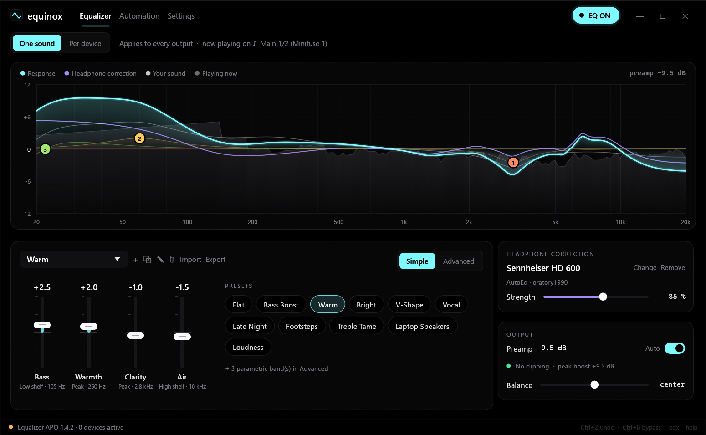
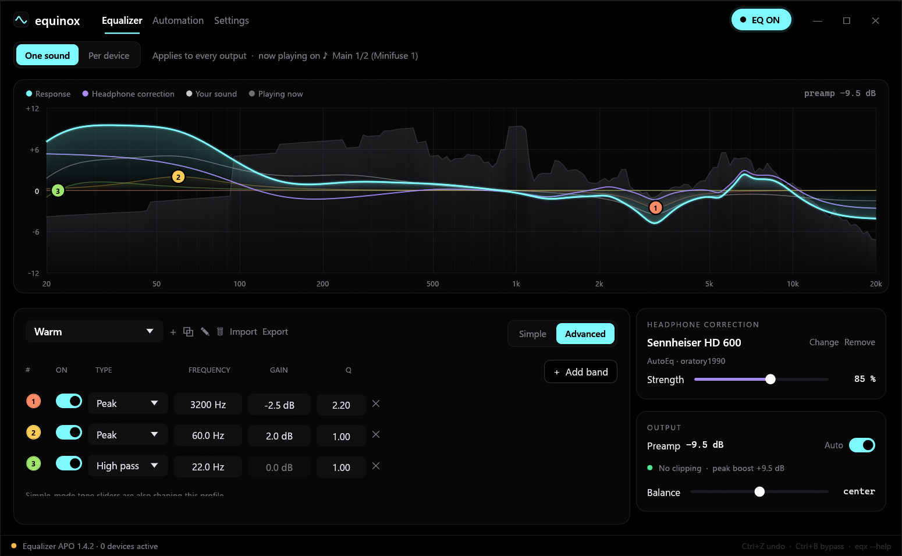
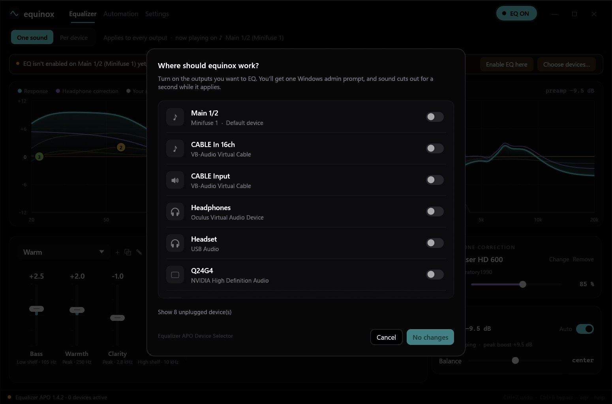
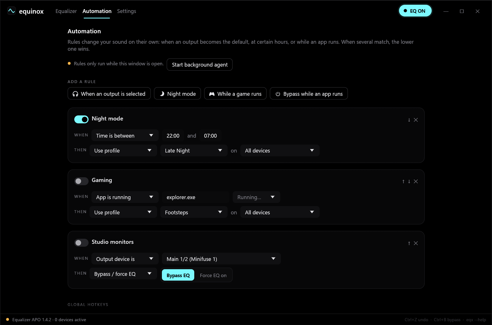

# equinox

<div align="center">
  
  <br>
  <b>A system-wide equalizer for Windows: per-device sound, measured headphone correction and automation, in one pure-black app.</b>
  <br>
  Simple sliders for everyone, a full parametric EQ for audiophiles, and a command line for everything.
  <br><br>
  <a href="https://github.com/visiuun/equinox/releases/latest">
    
  </a>
  <br><br>
  
  
  
  
</div>

<br>

<p align="center">
  
</p>

<p align="center">
  
  
</p>

<p align="center">
  
</p>

## At a glance

```text
Problem   Windows has no real equalizer. Headphones and speakers need different sound, every
          headphone model has its own frequency response, and switching presets by hand is tedious.

equinox   1. Run equinox.exe and click "Install" (one Windows prompt; it sets everything up).
          2. Click "Find my headphones", pick a preset, or drag a few sliders.
          Done. Every app is EQ'd, each output can sound different, and it starts with Windows.
```

**Examples**

| You want | In the app | From a terminal |
| --- | --- | --- |
| More bass, everywhere | Pick **Bass Boost**, or drag the **Bass** fader | `eqx use "bass boost"` |
| Your headphones to sound neutral | **Find my headphones** → type the model | `eqx autoeq apply sennheiser hd 600` |
| Keep a bit of their character | Drag **Strength** to 70% | `eqx strength 70` |
| A different sound on speakers vs headphones | **Per device** → pick the device → choose a profile | `eqx use "laptop speakers" -d speakers` |
| Hear the difference | **EQ ON** button, or **Ctrl+B** / **Ctrl+Alt+E** anywhere | `eqx toggle` |
| Quieter, softer sound at night | Automation → **Night mode** | (rules run in the background) |
| Footsteps louder while gaming | Automation → **While a game runs** | |
| Surgical fixes | **Advanced**: double-click the graph to add a band, drag it, scroll for Q | `eqx band add pk 3000 -2.5 2` |
| See the curve | It's the graph | `eqx curve` |

## Why this exists

Windows has no built-in equalizer that covers every app. The best audio engine for one is [Equalizer APO](https://sourceforge.net/projects/equalizerapo/): it runs inside the Windows audio pipeline, costs nothing and adds no latency. Using it, though, means editing text files, juggling per-device sections in a config language, copying AutoEq profiles around by hand, and fighting its Device Selector.

**equinox** puts a real app on top of it. You get a live graph, simple and advanced controls, measured headphone correction, per-device sound, automation and a CLI. It installs and configures Equalizer APO for you and rewrites its config every time you move something, so you never touch a text file.

## Features

- **Everything is set up for you.** On a fresh PC, one click downloads the official Equalizer APO installer, verifies its checksum, installs it silently and enables EQ on your current output. There's one Windows prompt and no reboot in most cases.
- **Simple device picker.** A Windows 11-style list of outputs with a switch each, instead of Equalizer APO's Device Selector. After applying, equinox confirms each device really works. If a driver needs a different install mode, it tries the others automatically, and the driver's own effects are kept and restored on removal.
- **System-wide.** Every app, including games and exclusive-mode players, with no virtual cables and no added latency.
- **One sound or per device.** Give headphones, speakers and your DAC their own chain. Settings survive unplugging and come back with the device.
- **Headphone correction.** Search about 9,000 measured headphones from [AutoEq](https://github.com/jaakkopasanen/AutoEq), or import your own measurement-based EQ. A 0–150% strength slider blends between the headphone's character and the neutral target.
- **Recognises your headphones.** Bluetooth and USB headsets report their model; equinox matches it against the database and offers the right correction.
- **Simple mode:** four large faders (Bass, Warmth, Clarity, Air) and eleven presets (Flat, Bass Boost, Warm, Bright, V-Shape, Vocal, Late Night, Footsteps, Treble Tame, Laptop Speakers, Loudness).
- **Advanced mode:** unlimited parametric bands (peak, low/high shelf, low/high pass, notch, band pass) with exact frequency, gain and Q.
- **Interactive graph** using the same RBJ biquads Equalizer APO runs, so what you see is what you hear. It shows the headphone correction, your sound and the combined response over a **live spectrum of what's playing**.
- **Never clips.** The auto preamp lowers gain by exactly what your boosts need.
- **Honest A/B.** Bypass is level-matched, so "on" doesn't win just by being louder.
- **Automation.** Rules switch profile, bypass or correction strength when an output becomes the default, during a time window, or while an app runs.
- **Global hotkeys:** Ctrl+Alt+E bypass, Ctrl+Alt+. and Ctrl+Alt+, for next and previous profile.
- **Command line** (`eqx`) for everything, with `--json` output for scripts, Stream Deck and AutoHotkey. The open app updates live.
- **Import and export** Equalizer APO, AutoEq `ParametricEQ.txt`, REW filter exports, `GraphicEQ:` lines and "Hz, dB" CSV curves.
- **Undo/redo** for everything. A whole drag counts as one step.
- **Light:** about 8 MB, a few percent of one core while the spectrum animates and none when hidden, with no runtime or .NET.

## Install

1. Download **`equinox-x64.zip`** from the [latest release](https://github.com/visiuun/equinox/releases/latest) (`equinox-x86.zip` for 32-bit Windows) and unzip it anywhere.
2. Run **`equinox.exe`**. If SmartScreen appears, click **More info → Run anyway** (the exe isn't code-signed).
3. Click **Install** in the banner and approve the Windows prompt. If you already use Equalizer APO, click **Set up** instead; your previous config is backed up.

That's it. On first launch equinox also turns on **Start with Windows**: it copies itself to `%LOCALAPPDATA%\equinox\` and starts a small tray agent at sign-in (no admin, no scheduled task). The EQ keeps working even when equinox isn't running, because Equalizer APO applies the last config.

To EQ more outputs later, click **Choose devices…** (Equalizer page banner or Settings).

## Using equinox

### The graph

| Do | To |
| --- | --- |
| Drag a node | Move the band's frequency and gain (hold **Shift** for fine control) |
| Scroll over a node | Change Q (bandwidth) |
| Double-click empty space | Add a peak band there |
| Right-click | Change the filter type, disable, reset or delete a band, or add one at the cursor |
| Arrow keys | Nudge the selected band: ←/→ 1/12 octave, ↑/↓ 0.5 dB (**Shift**: 1/48 octave, 0.1 dB) |
| **Delete** | Remove the selected band |
| **Ctrl+Z / Ctrl+Y** | Undo / redo |
| **Ctrl+B** | Bypass (level-matched) |

Curves: the **accent** line is the combined response you hear, **violet** is the headphone correction, and **white** is your own sound on top of it. Grey behind them is the live spectrum of the current output.

### One sound vs per device

- **One sound:** a single chain on every output.
- **Per device:** each output can have its own chain (right-click a device chip → *Give it its own sound*). The rest follow **Default**. The ▸ marks the current Windows output; an amber dot means EQ isn't enabled on that device yet.

### Headphone correction

The correction is applied first, then your sound on top, so you can start from a neutral, measured base and still add the bass you like. **Strength** scales it: 100% is the full measured fix, lower keeps some of the original character, and above 100% exaggerates it. Profiles download once and are cached for offline use.

### Automation

Rules are checked every second by the tray agent (or by the window while it's open). When several match, the lowest one in the list wins. An active rule is shown as a banner on the Equalizer page and can be switched off from there.

### Command line

`eqx.exe` sits next to `equinox.exe` (and in `%LOCALAPPDATA%\equinox\` once start-with-Windows is on). **Settings → Command line → Add to PATH** lets you type `eqx` anywhere.

```text
eqx status [--json]                      what's applied where (default command)
eqx devices | profiles                   list outputs / profiles
eqx use <profile> [-d <device>]          switch profile; -d gives that device its own chain
eqx on | off | toggle                    EQ on / bypass
eqx mode global | per-device
eqx tone --bass 3 --air -1 [-p <name>]   simple-mode sliders (dB)
eqx band list|add|set|rm|clear           parametric bands: eqx band add pk 3000 -2.5 2
eqx preamp auto | <dB>                   eqx balance <dB>
eqx autoeq search <model>                eqx autoeq apply <model> [--pick N] [--strength 80]
eqx autoeq suggest | clear | refresh     eqx strength <percent>
eqx profile new|copy|rename|rm           eqx import <file> [--correction]    eqx export [-o file]
eqx rules [list|enable|disable|rm]       eqx agent start|stop|status
eqx apo install                          download + install Equalizer APO, enable the default output
eqx apo enable|disable <device>...       turn EQ on/off for outputs (one admin prompt, verified)
eqx apo status|hook|release|selector     eqx startup on|off    eqx curve    eqx open
```

Devices (`-d`) match by part of the name (`-d headphones`), GUID or `default`. `-d all` targets the global chain.

```console
> eqx autoeq apply hd 600 --strength 85
Sennheiser HD 600 (oratory1990) → all devices, 10 filters

> eqx curve
 +10 dB
        ●●●●●●●●●
        │││││││││●●●
        ││││││││││││●●                                       ●
   0 dB ··················●●●●●●●●●●●●●●●●●●●●·●●●●●●●··●●●●····●·······
                                              ●       ●●         ●││││││
                                                                    ●●●●
 -10 dB
        20     50     100   200     500    1k    2k      5k     10k   20k
        preamp -9.1 dB   peak +9.0 dB
```

## How it works

```text
equinox.exe / eqx.exe ──► %APPDATA%\equinox\state.json   (profiles, devices, rules, settings)
          │
          └─ renders ──► C:\Program Files\EqualizerAPO\config\equinox.txt
                              ▲ included by config.txt
                         Equalizer APO (inside Windows audio) re-reads it instantly
```

- **Processing:** Equalizer APO's biquad filters at the device's sample rate. equinox computes the same filters at 48 kHz for the graph and the anti-clipping preamp.
- **Per device:** `Device:` sections keyed by endpoint GUID. Devices that follow Default share one section.
- **Device setup:** the same registry layout as Equalizer APO's Device Selector (originals backed up under `HKLM\SOFTWARE\EqualizerAPO\Child APOs`), followed by an audio service restart and a check over Equalizer APO's test pipe. This runs in an elevated helper (`equinox.exe --apo-setup`), so the app itself never needs admin.
- **Sync:** the app, `eqx` and the tray agent all edit `state.json` and watch it, so a change in one shows up in the others within half a second.
- **Spectrum:** WASAPI loopback on the default output with a 4096-point FFT. Nothing is recorded or stored.

## Troubleshooting

| Symptom | Fix |
| --- | --- |
| Banner: *EQ isn't enabled on …* | Click **Enable EQ here** and approve the prompt. If a device reports "not confirmed", restart Windows once. |
| Banner: *Equalizer APO isn't loading equinox* | Click **Use equinox**. Your old `config.txt` is saved as `config.before-equinox.txt`. |
| Another EQ app is also active | Settings → Equalizer APO lists other lines in `config.txt`. **Use equinox** replaces them; **Restore previous config** brings them back. |
| No change on Bluetooth headphones | Windows creates separate *Headphones* and *Headset (Hands-Free)* outputs. Enable EQ on the one you play through. |
| A device misbehaves after enabling | Switch it off in **Choose devices…** (or `eqx apo disable <device>`); the driver's original effects are restored. Equalizer APO's own Device Selector is linked there too, for its troubleshooting options. |
| Hotkeys don't work | Another app owns the combination, or hotkeys are off in Settings. The tray agent must be running (`eqx agent start`). |

## Uninstall

1. In equinox: switch your outputs off in **Choose devices…**, then Settings → turn off **Start with Windows** → **Equalizer APO → Restore previous config**. From a terminal: `eqx apo disable <device>`, `eqx startup off`, `eqx apo release`.
2. Delete `%LOCALAPPDATA%\equinox\` (installed copy) and `%APPDATA%\equinox\` (settings and AutoEq cache).
3. Uninstall Equalizer APO from Windows settings if you no longer need it.

## Build from source

```powershell
git clone https://github.com/visiuun/equinox
cd equinox
cargo build --release      # target\release\equinox.exe and eqx.exe
cargo test
```

You need [Rust](https://rustup.rs) and the MSVC build tools (*Desktop development with C++*, or just *MSVC* and the *Windows SDK*). `rust-toolchain.toml` picks the right toolchain automatically and Cargo fetches every dependency. The C runtime is linked statically, so the exes run on a clean Windows install. Every push is built and tested by [GitHub Actions](.github/workflows/build.yml), and release zips are attached by the same workflow.

## License

**[CC BY-NC 4.0](LICENSE)**. You're free to use, share, modify and build on equinox, as long as you:

- **credit** Visiuun and link back to this repository, and
- **don't use it commercially** (no selling it, bundling it in paid products, or using it for paid services).

For commercial licensing, open an issue.

## Credits

Created by [Visiuun](https://github.com/visiuun).

Audio processing by [Equalizer APO](https://sourceforge.net/projects/equalizerapo/) (Jonas Thedering). Headphone measurements and EQ from [AutoEq](https://github.com/jaakkopasanen/AutoEq) (Jaakko Pasanen) and its measurement sources. Both are separate projects with their own licenses; equinox downloads them from their official sources and doesn't redistribute them.
